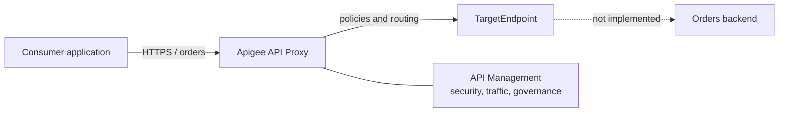

# Google Cloud Apigee architecture lab

A declarative lab for a technical presentation about API Management with Google Cloud Apigee. A fictitious orders API progresses from a minimal proxy to access and traffic controls, then to JWT, Shared Flows, and consistent fault handling.

> **Scope:** XML bundles, documentation, diagrams, and static validation. This repository provisions no GCP infrastructure, working backend, credentials, deployment pipeline, or external integration. Reserved `example.invalid` hosts prevent accidental production use.

## API Gateway and API Management

An API gateway sits in the execution path: it receives calls, enforces policies, and routes traffic. API Management is broader and covers design, security, publishing, products, lifecycle, observability, and governance. Apigee combines a gateway runtime with management capabilities; this lab focuses on runtime configuration.



The `ProxyEndpoint` defines the consumer-facing interface and inbound/outbound flows. The `TargetEndpoint` defines the backend connection. Policies are configurable units attached to Steps in those flows.

## Modules and suggested path

| Module | Focus | Runtime status |
|---|---|---|
| [01 — Basic](examples/01-basic/README.md) | API Proxy, endpoints, RouteRule | Structurally valid bundle; fictitious backend |
| [02 — Intermediate](examples/02-intermediate/README.md) | API key, SpikeArrest, Quota, AssignMessage, conditional flow | Requires product/app/key in Apigee |
| [03 — Advanced](examples/03-advanced/README.md) | JWT, Shared Flow, FlowCallout, FaultRules | Requires JWKS private variable and ordered deployment |

Follow the numeric order. Compare each module's `PreFlow` to see the policy chain grow, and use the [presentation guide](docs/en/presentation-guide.md) for a 30-minute session.

## Presentation

The Brazilian Portuguese technical deck uses Reveal.js, Markdown, XML highlighting, local SVG diagrams, and speaker notes. Code excerpts and diagrams are extracted from the lab sources during the build.

```bash
npm ci --prefix presentation
npm start --prefix presentation
```

Open <http://127.0.0.1:8000>. Navigate with the arrow keys, press `O` for the overview, and `S` for speaker notes. Build and validate the static distribution with:

```bash
npm run validate:mermaid --prefix presentation
npm run generate:speaker-script --prefix presentation
npm run build --prefix presentation
npm run validate --prefix presentation
```

The output is written to `presentation/dist/`; keep the complete folder and serve it over HTTP. Slides show each example path and link to its matching GitHub source. See the [presentation-specific guide](presentation/README.md) for branch configuration, alternate ports, and generation details.

After changes reach the `main` branch, the `Publish presentation` workflow validates and publishes that same distribution to [GitHub Pages](https://rodri-oliveira-dev.github.io/apigee-architecture-lab/). It can also be started manually from the Actions tab. Pull requests only validate and never publish content.

### VS Code Workspace

With Node.js 22.13+, npm 10+, and Python 3.11+ installed, open [`apigee-architecture-lab.code-workspace`](apigee-architecture-lab.code-workspace) in VS Code. The workspace recommends XML, Markdown, and Mermaid extensions and provides tasks to install dependencies, start or build the deck, validate bundles and diagrams, run tests, and execute `Quality: Validate All` in sequence.

The **Presentation: Open in Browser** launch configuration waits for the server's readiness message and opens <http://127.0.0.1:8000>. If no Chromium browser compatible with VS Code debugging is available, run **Presentation: Start** and open the URL manually. Press `S` for Speaker View; the Portuguese [speaker script](docs/pt-br/speaker-script.md) can also be studied or printed without Reveal.js.

## Local validation

Python 3.11+ is required; there are no third-party dependencies.

```bash
python scripts/validate_bundles.py
python -m unittest discover -s tests -v
```

The validator checks well-formed XML, structural files, Step references, RouteRules, policy/file names, FlowCallouts, and required docs. It does **not** implement Apigee's internal schemas and cannot replace platform import, deployment validation, Debug, or runtime tests.

## What requires Google Cloud

A real run requires a provisioned Apigee organization and instance, environment/environment group and hostname, reachable backend, API product and app for API keys, trusted JWKS material, and imported/deployed bundles. None is created here. Read the [architecture](docs/en/architecture.md), [validation boundaries](docs/en/validation.md), and [architecture decisions](docs/en/architectural-decisions.md).

## Official references

- [Understanding APIs and API proxies](https://cloud.google.com/apigee/docs/api-platform/fundamentals/understanding-apis-and-api-proxies)
- [API proxy configuration reference](https://cloud.google.com/apigee/docs/api-platform/reference/api-proxy-configuration-reference)
- [Policy reference](https://cloud.google.com/apigee/docs/api-platform/reference/policies/reference-overview-policy)
- [Reusable Shared Flows](https://cloud.google.com/apigee/docs/api-platform/fundamentals/shared-flows)
- [Fault handling](https://cloud.google.com/apigee/docs/api-platform/fundamentals/fault-handling)

Documentação em português: [README.md](README.md).
