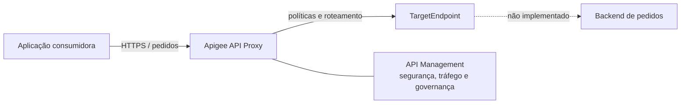

# Laboratório de arquitetura Google Cloud Apigee

Laboratório declarativo para uma apresentação técnica sobre API Management com o Google Cloud Apigee. A API fictícia de pedidos evolui de um proxy mínimo para controles de acesso e tráfego e, por fim, JWT, Shared Flows e tratamento uniforme de falhas.

> **Escopo:** bundles XML, documentação, diagramas e validação estática. Não há infraestrutura GCP, backend funcional, credenciais, deploy ou integração externa. Os hosts `example.invalid` são reservados e impedem uso acidental como produção.

## API Gateway e API Management

Um gateway ocupa o caminho de execução: recebe chamadas, aplica políticas e encaminha tráfego. API Management é mais amplo: inclui desenho, segurança, publicação, produtos, ciclo de vida, observabilidade e governança. O Apigee combina o runtime de gateway com capacidades de gestão; este laboratório concentra-se na configuração do runtime.



No proxy, o `ProxyEndpoint` define a interface voltada ao consumidor e os fluxos de entrada/saída. O `TargetEndpoint` define a conexão com o backend. Policies são unidades configuráveis anexadas aos Steps desses fluxos.

## Módulos e trilha sugerida

| Módulo | Foco | Estado executável |
|---|---|---|
| [01 — Básico](examples/01-basic/README.md) | API Proxy, endpoints e RouteRule | Bundle estruturalmente válido; backend fictício |
| [02 — Intermediário](examples/02-intermediate/README.md) | API key, SpikeArrest, Quota, AssignMessage e fluxo condicional | Exige produto/app/chave no Apigee |
| [03 — Avançado](examples/03-advanced/README.md) | JWT, Shared Flow, FlowCallout e FaultRules | Exige JWKS em variável privada e deploy ordenado |

Siga a ordem numérica. Compare o `PreFlow` dos módulos para perceber como a cadeia de políticas cresce e use o [roteiro de apresentação](docs/pt-br/presentation-guide.md) para uma sessão de 30 minutos.

## Validação local

Requer Python 3.11 ou mais recente; não há dependências externas.

```bash
python scripts/validate_bundles.py
python -m unittest discover -s tests -v
```

O validador verifica XML bem formado, arquivos estruturais, referências de Steps, RouteRules, nomes de policies, FlowCallouts e documentação obrigatória. Ele **não** implementa os schemas internos do Apigee e não substitui importação, validação de deploy, Debug nem testes de runtime na plataforma.

## O que requer Google Cloud

Uma execução real requer organização e instância Apigee provisionadas, environment/environment group e hostname, backend alcançável, produto de API e app para API keys, material JWKS confiável e bundles importados/deployados. Nenhum desses recursos é criado aqui. Veja [arquitetura](docs/pt-br/architecture.md), [limites da validação](docs/pt-br/validation.md) e [decisões arquiteturais](docs/pt-br/architectural-decisions.md).

## Referências oficiais

- [Entendendo APIs e API proxies](https://cloud.google.com/apigee/docs/api-platform/fundamentals/understanding-apis-and-api-proxies)
- [Referência de configuração de API Proxy](https://cloud.google.com/apigee/docs/api-platform/reference/api-proxy-configuration-reference)
- [Referência de Policies](https://cloud.google.com/apigee/docs/api-platform/reference/policies/reference-overview-policy)
- [Shared Flows reutilizáveis](https://cloud.google.com/apigee/docs/api-platform/fundamentals/shared-flows)
- [Tratamento de falhas](https://cloud.google.com/apigee/docs/api-platform/fundamentals/fault-handling)

English documentation: [README.en.md](README.en.md).
