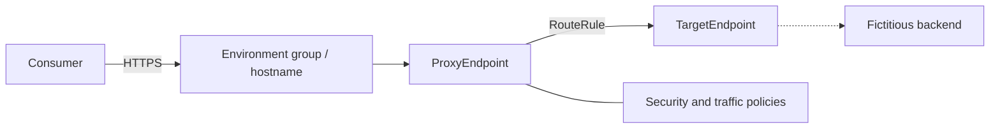
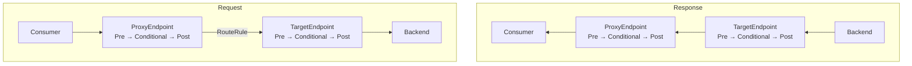
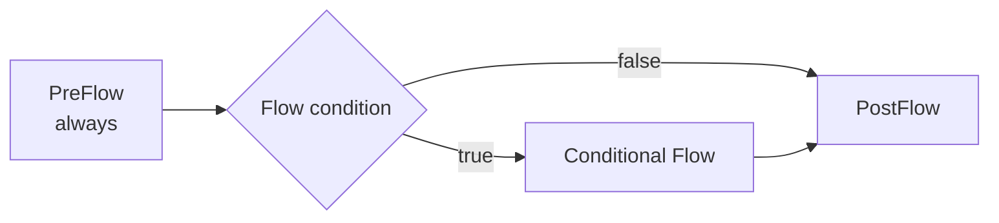

# Architecture and execution model

## Overview

The lab separates the public contract, gateway processing, and target connection. Apigee does not replace the backend; it provides a management and policy-enforcement layer.

## Message lifecycle

On the request path, execution crosses the ProxyEndpoint and TargetEndpoint before reaching the backend. On the response path, endpoint traversal is reversed: TargetEndpoint first, then ProxyEndpoint. Inside each request or response pipeline, however, the order remains `PreFlow → Conditional Flow → PostFlow`. Only the first matching Conditional Flow runs in each segment. Within each Flow, Steps run in declaration order; an error with `continueOnError="false"` leaves the normal pipeline.

## Design progression

- **Basic:** explicit boundary and routing.
- **Intermediate:** application authentication, capacity protection, consumption governance, and enrichment.
- **Advanced:** JWT identity, reusable composition, and an error contract.

Policies are configuration, not substitutes for architecture decisions. Limits, ordering, conditions, identity, sensitive data, and observability need explicit criteria. Shared Flows reduce duplication but introduce deployment and versioning dependencies between artifacts.

## Lab boundary

The bundles follow the documented layout and are checked for relationships the repository can prove. The platform must still validate schemas, policy availability, runtime variables, organization/environment resources, connectivity, and distributed behavior.

References: [proxy structure](https://cloud.google.com/apigee/docs/api-platform/fundamentals/structure-api-proxies), [flow execution order](https://cloud.google.com/apigee/docs/api-platform/fundamentals/what-are-flows), [proxy configuration](https://cloud.google.com/apigee/docs/api-platform/reference/api-proxy-configuration-reference), and [flow variables](https://cloud.google.com/apigee/docs/api-platform/fundamentals/introduction-flow-variables).
