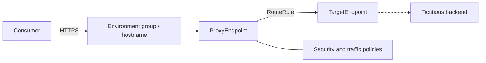
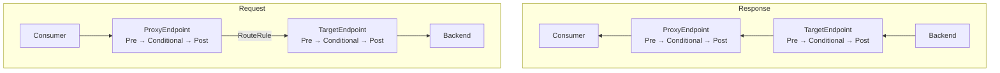
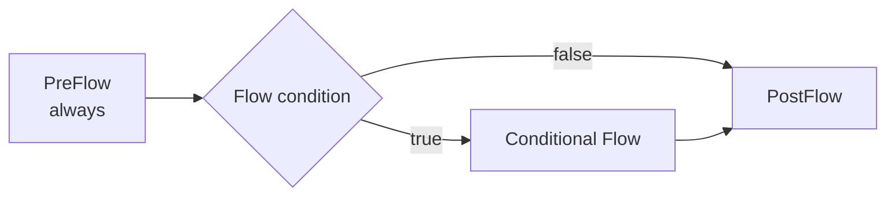

# Architecture and execution model

## Overview

The lab separates the public contract, gateway processing, and target connection. Apigee does not replace the backend; it provides a management and policy-enforcement layer.

## Message lifecycle

On the request path, execution crosses the ProxyEndpoint and TargetEndpoint before reaching the backend. On the response path, endpoint traversal is reversed: TargetEndpoint first, then ProxyEndpoint. Inside each request or response pipeline, however, the order remains `PreFlow → Conditional Flow → PostFlow`. Only the first matching Conditional Flow runs in each segment. Within each Flow, Steps run in declaration order; an error with `continueOnError="false"` leaves the normal pipeline.

## Design progression

- **Basic:** explicit boundary and routing.
- **Intermediate:** application authentication, capacity protection, external configuration, multiple targets, and enrichment.
- **Advanced:** JWT identity, reusable composition, and an error contract.

Policies are configuration, not substitutes for architecture decisions. Limits, ordering, conditions, identity, sensitive data, and observability need explicit criteria. Shared Flows reduce duplication but introduce deployment and versioning dependencies between artifacts.

## External configuration and multiple targets

The independent `orders-routing` extension keeps one public contract while declaring two fictitious TargetEndpoints. `KeyValueMapOperations` reads the non-sensitive `backend-region` entry from an environment-scoped KVM into `private.lab.backend.region`. Retrieval uses `continueOnError="true"` only to reach a controlled RaiseFault when the KVM/entry cannot be read or the value is missing or unsupported. A conditional AssignMessage uses the validated variable for technical request context.

RouteRules are evaluated top-down. The conditional `secondary-route` is declared first and the unconditional `primary-fallback` last. Validation prevents unsupported values from silently reaching the fallback. The KVM and entry must already exist in an Apigee environment; the bundle contains no `InitialEntries` and this repository performs no KVM operation.

## Bundle structure and authoring

This lab uses the traditional Apigee XML bundle: `proxies/`, `targets/`, `policies/`, optional `resources/`, and a root descriptor. Descriptor lists such as `Policies` and `TargetEndpoints` are optional manifest-like metadata, often generated by the UI. A `manifests/` directory is not part of the documented standard structure, so no artificial directory is added. XML is the repository's versionable teaching representation, not the platform's only authoring experience; Apigee also supports UI and API workflows.

## Lab boundary

The bundles follow the documented layout and are checked for relationships the repository can prove. The platform must still validate schemas, policy availability, runtime variables, organization/environment resources, connectivity, and distributed behavior.

References: [proxy structure](https://cloud.google.com/apigee/docs/api-platform/fundamentals/structure-api-proxies), [flow execution order](https://cloud.google.com/apigee/docs/api-platform/fundamentals/what-are-flows), [proxy configuration](https://cloud.google.com/apigee/docs/api-platform/reference/api-proxy-configuration-reference), [routes](https://cloud.google.com/apigee/docs/api-platform/fundamentals/understanding-routes), [KeyValueMapOperations](https://cloud.google.com/apigee/docs/api-platform/reference/policies/key-value-map-operations-policy), and [flow variables](https://cloud.google.com/apigee/docs/api-platform/fundamentals/introduction-flow-variables).
