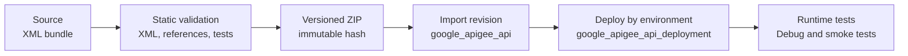

# Bundles and the Terraform deployment lifecycle

## Separate artifact from provisioning

The XML bundle describes API Proxy behavior. Terraform can import that artifact and manage its deployment alongside platform resources, while proxy policies and flows remain separate from organization, environment, and network provisioning.

The Google provider publicly documents `google_apigee_api`, which consumes a `config_bundle`, and `google_apigee_api_deployment`, which binds a proxy revision to an environment. These are official provider resources, not private module interfaces. This lab intentionally includes no runnable Terraform because it has no organization, environments, reachable backend, or shared state.

Reusable modules should keep inputs explicit and preserve dependencies between proxies, environments, KVMs, Shared Flows, and deployments. A pipeline should build a deterministic ZIP, record its hash and version, run static and security checks, promote the same artifact across environments, and perform import/deploy plus runtime tests in a non-production environment.

Remote state needs encryption, least-privilege access, locking where supported, recovery/versioning, and auditability. Never commit state to Git or expose it in logs. Splitting state by responsibility and environment limits blast radius but requires clear contracts between stacks.

Official references: [`google_apigee_api`](https://registry.terraform.io/providers/hashicorp/google/latest/docs/resources/apigee_api), [`google_apigee_api_deployment`](https://registry.terraform.io/providers/hashicorp/google/latest/docs/resources/apigee_api_deployment), and [Terraform remote state](https://developer.hashicorp.com/terraform/language/state/remote).
