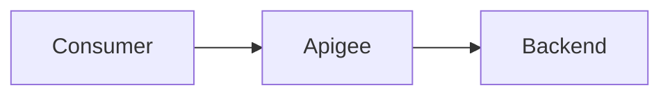
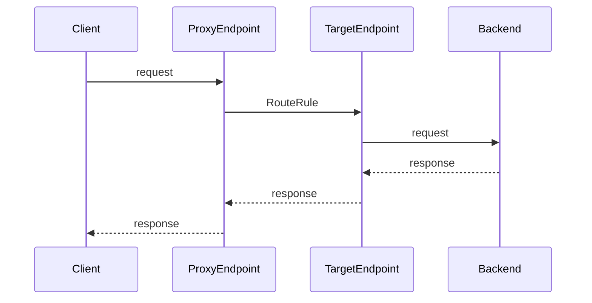
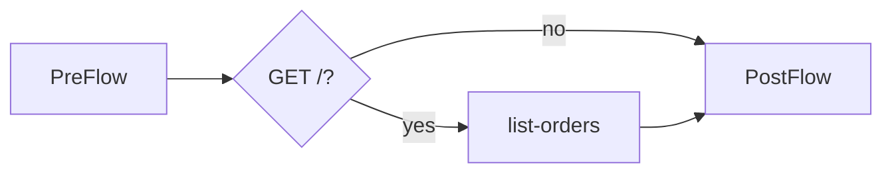
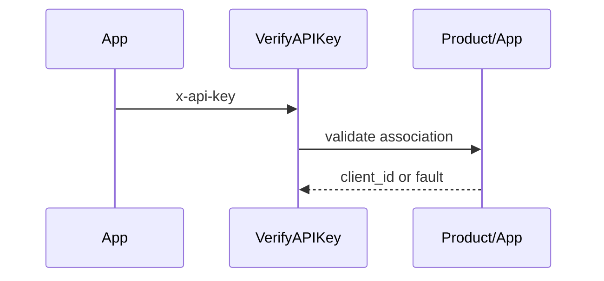
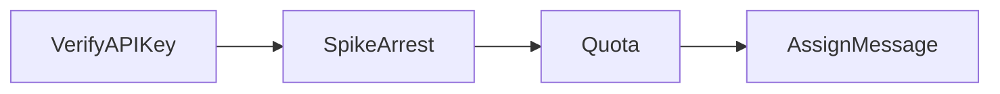
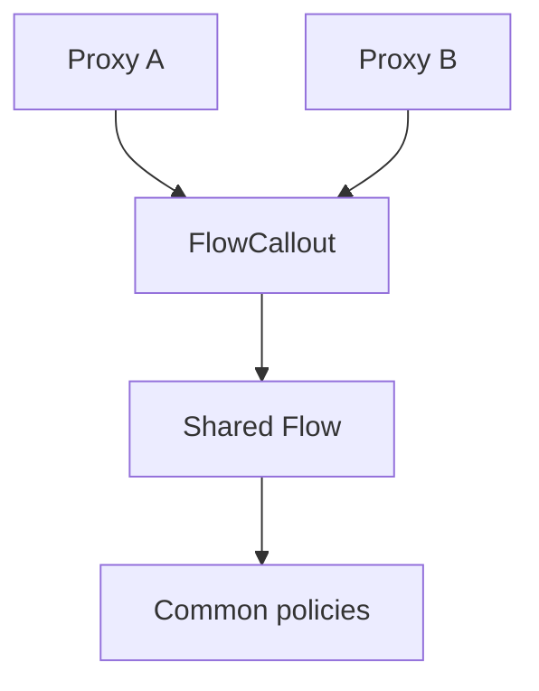
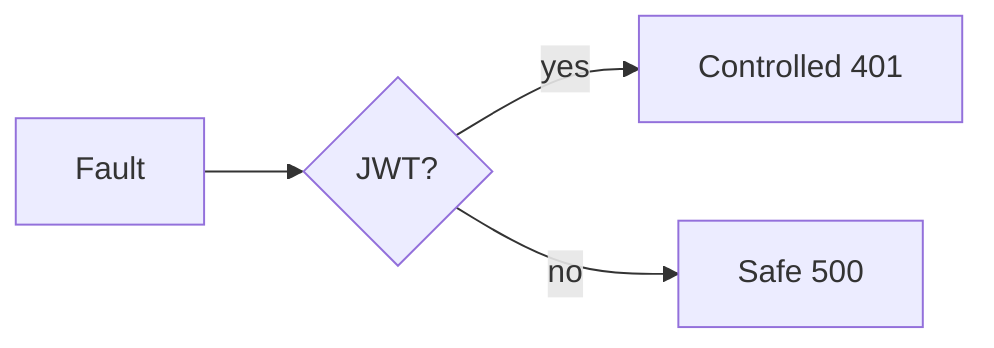

# Presentation guide — 30 minutes

Audience: developers and software architects. Timings total 30 minutes, with questions after the session.

> The executable Brazilian Portuguese deck adapts this guide into 12 slides under [`presentation/`](../../presentation/README.md). Its build extracts XML examples and diagrams directly from the files referenced below.

## Slide 1 — Why an API layer? (2 min)

- **Objective:** align on the problem and scope.
- **Concepts:** contracts, decoupling, gateway versus API Management.
- **Suggested narrative:** “A gateway is in the call path; API Management also governs lifecycle, security, and consumption. We are studying declarative runtime configuration, not claiming a production-ready platform.”
- **Repository example:** `README.en.md` and the orders scenario.
- **Takeaway:** a proxy is a managed boundary, not merely a redirect.

## Slide 2 — Bundle anatomy (2 min)

- **Objective:** locate each element in the repository.
- **Concepts:** descriptor, `ProxyEndpoint`, `TargetEndpoint`, policies, resources.
- **Suggested narrative:** names form contracts between files: a Step references a policy and a RouteRule references a TargetEndpoint.
- **Repository example:** `examples/01-basic/apiproxy/`.
- **Takeaway:** directory structure is part of the deployable artifact.

## Slide 3 — End-to-end message path (3 min)

- **Objective:** explain temporal ordering.
- **Concepts:** request/response and proxy/target segments.
- **Suggested narrative:** follow the request to the backend, then point out the reversed segment order on the response path.
- **Repository example:** the basic `proxies/default.xml`.
- **Takeaway:** policy placement determines when and against which message it runs.

## Slide 4 — PreFlow, conditions, and PostFlow (3 min)

- **Objective:** separate cross-cutting logic from operation-specific logic.
- **Concepts:** always-on PreFlow, Conditions, and PostFlow.
- **Suggested narrative:** authentication belongs in PreFlow; list-only behavior can live in `list-orders`; common post-processing belongs in PostFlow.
- **Repository example:** the intermediate ProxyEndpoint.
- **Takeaway:** conditions express business intent; Step order expresses dependencies.

## Slide 5 — API key as application identity (3 min)

- **Objective:** demonstrate application access control.
- **Concepts:** API product, developer app, key, and `client_id`.
- **Suggested narrative:** the policy extracts `x-api-key`, but authorization depends on Apigee-managed metadata. An API key identifies an application, not necessarily an end user.
- **Repository example:** module 02 `verify-api-key.xml`.
- **Takeaway:** XML configuration and management-plane resources must coexist.

## Slide 6 — Protect capacity and govern consumption (3 min)

- **Objective:** distinguish SpikeArrest from Quota.
- **Concepts:** bursts, smoothed rates, windows, and identifiers.
- **Suggested narrative:** SpikeArrest reduces instantaneous spikes; Quota accounts for usage by `client_id`. Lab values demonstrate syntax, not production sizing.
- **Repository example:** `spike-arrest.xml` and `quota.xml`.
- **Takeaway:** limits are capacity and product decisions backed by evidence.

## Slide 7 — Compose the policy chain (3 min)

- **Objective:** make inter-step dependencies explicit.
- **Concepts:** fail-closed behavior, flow variables, AssignMessage.
- **Suggested narrative:** VerifyAPIKey produces the `client_id` consumed by Quota; correlation is added after controls. A failure prevents later Steps from running.
- **Repository example:** module 02 PreFlow.
- **Takeaway:** a correct policy in the wrong position can still create an incorrect architecture.

## Slide 8 — JWT and trust boundaries (3 min)

- **Objective:** introduce signed identity and local verification.
- **Concepts:** RS256, issuer, audience, expiry, and JWKS.
- **Suggested narrative:** a valid signature is not sufficient; verify issuer and audience. The bundle expects JWKS in a private variable and does not implement key retrieval or rotation.
- **Repository example:** advanced `verify-jwt.xml`.
- **Takeaway:** keys and claims define a trust boundary that requires secure operations.

## Slide 9 — Reuse with Shared Flows (3 min)

- **Objective:** show composition without policy copying.
- **Concepts:** SharedFlowBundle, FlowCallout, deployment dependency.
- **Suggested narrative:** the consumer calls a bundle deployed to the same environment. A Shared Flow is not an endpoint and must be deployed first.
- **Repository example:** both module 03 bundles.
- **Takeaway:** reuse reduces drift but requires version and rollout governance.

## Slide 10 — Faults as contract behavior (2 min)

- **Objective:** explain the transition into error state.
- **Concepts:** FaultRule, DefaultFaultRule, non-disclosing messages.
- **Suggested narrative:** faults leave the normal pipeline; `JWT.failed` routes all JWT-policy failures to 401 and the fallback covers everything else. ProxyEndpoint and TargetEndpoint have separate handlers because rules belong where errors can occur.
- **Repository example:** advanced ProxyEndpoint FaultRules.
- **Takeaway:** error responses deserve the same design and testing rigor as success responses.

## Slide 11 — Guardrails and next steps (3 min)

- **Objective:** close with an honest validation boundary.
- **Concepts:** XML, referential integrity, minimal CI, platform validation.
- **Suggested narrative:** run the script and tests. CI fails early without credentials but does not promise semantic compatibility. Possible next steps are a sandbox, runtime tests, OpenAPI, observability, and secure configuration management.
- **Repository example:** validator, tests, and GitHub workflow.
- **Takeaway:** local automation reduces mistakes; only Apigee and real tests confirm runtime behavior.
