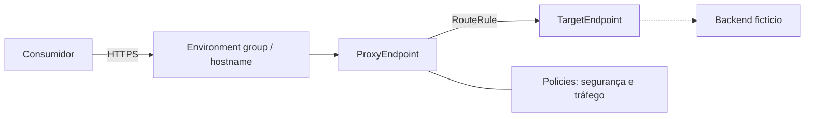
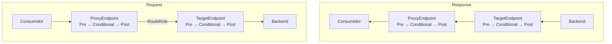
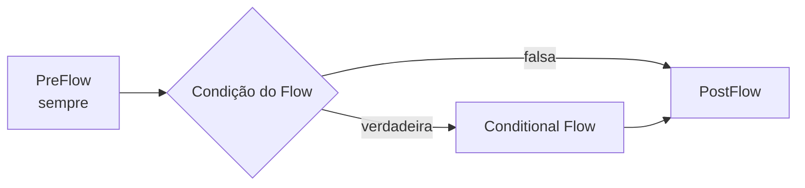

# Arquitetura e modelo de execução

## Visão geral

O laboratório separa contrato público, processamento do gateway e conexão de destino. O Apigee não substitui o backend: ele forma uma camada de gestão e aplicação de políticas.

## Ciclo de uma mensagem

No request, o fluxo atravessa ProxyEndpoint e TargetEndpoint antes do backend. Na resposta, a travessia entre endpoints ocorre no sentido inverso: primeiro o TargetEndpoint e depois o ProxyEndpoint. Em cada pipeline de request ou response, porém, a ordem interna permanece `PreFlow → Conditional Flow → PostFlow`. Somente o primeiro Conditional Flow cuja condição for verdadeira executa em cada segmento. Dentro de cada Flow, os Steps executam na ordem declarada; um erro com `continueOnError="false"` abandona o pipeline normal.

## Progressão do desenho

- **Básico:** fronteira e roteamento explícitos.
- **Intermediário:** autenticação de aplicação, proteção de capacidade, configuração externa, múltiplos destinos e enriquecimento.
- **Avançado:** identidade por JWT, composição reutilizável e contrato de erros.

Policies são configuração, não substitutos automáticos para decisões arquiteturais. Limites, ordem, condições, identidade, dados sensíveis e observabilidade precisam de critérios próprios. Shared Flows reduzem duplicação, mas criam uma dependência de deploy e versionamento entre artefatos.

## Identidade da aplicação e da credencial

No módulo intermediário, `VerifyAPIKey` valida a consumer key apresentada em `x-api-key` e produz variáveis com a chave e os metadados associados. `verifyapikey.verify-api-key.client_id` contém essa consumer key — também chamada API key ou app key — enquanto `verifyapikey.verify-api-key.developer.app.name` representa o nome da aplicação cadastrada. O proxy usa `client_id` como `Identifier` da Quota, portanto contabiliza por credencial: múltiplas chaves da mesma aplicação e uma chave nova após rotação têm contadores independentes.

Como o `SpikeArrest` vem depois de `VerifyAPIKey`, chamadas com credencial inválida falham antes dessa proteção contra rajadas; o bundle não mitiga nessa policy as tentativas anônimas. A proteção de borda anterior à autenticação é uma decisão separada. Aqui, o SpikeArrest aplica `10ps` ao proxy (sem `Identifier`), em janela deslizante regional com `UseEffectiveCount=true`; a Quota limita 100 requisições/minuto por consumer key em janela móvel. Esses valores são apenas didáticos.

Depois da validação, uma `AssignMessage` remove `x-api-key`. As policies seguintes continuam usando as variáveis produzidas por `VerifyAPIKey`, mas a credencial não é enviada ao backend sem necessidade. O módulo avançado aplica o mesmo princípio ao header `Authorization`: valida o JWT, remove o bearer token e envia ao target somente o subject necessário, produzido pelo Shared Flow.

## Configuração externa e múltiplos destinos

A extensão `orders-routing` mantém um único contrato público e declara dois TargetEndpoints fictícios. A policy `KeyValueMapOperations` lê `backend-region` de uma KVM no escopo do environment e atribui o valor a `private.lab.backend.region`. O prefixo `private.` evita exposição do conteúdo recuperado em Debug; embora o valor do exemplo não seja sensível, ele mantém a prática segura exigida para KVMs criptografadas.

A leitura usa `continueOnError="true"` exclusivamente para alcançar uma `RaiseFault` controlada quando a KVM/entrada não puder ser lida, estiver ausente ou não for `primary` nem `secondary`. Uma `AssignMessage` condicional usa a variável válida para acrescentar contexto técnico à requisição. Por fim, as RouteRules são avaliadas de cima para baixo: `secondary-route` possui condição e vem primeiro; `primary-fallback`, sem condição, vem por último. Assim, o fallback só é alcançado depois da validação explícita.

O bundle não contém `InitialEntries` e não provisiona a KVM. O environment precisa possuir a KVM `orders-routing-config` e sua entrada antes de um teste real. Essa capacidade é uma opção de desenho, não uma regra para todas as APIs nem um substituto automático para gestão de segredos.

## Estrutura do bundle e autoria

Este laboratório usa o formato tradicional de bundle XML do Apigee. `proxies/` contém ProxyEndpoints, `targets/` contém TargetEndpoints, `policies/` contém policies e `resources/` é usado somente quando existem scripts, JARs ou XSLT. O descritor XML na raiz identifica o proxy; listas como `Policies` e `TargetEndpoints` são metadados opcionais e podem ser geradas pela UI.

`manifests/` não aparece porque não integra a estrutura padrão documentada para esse tipo de bundle. Nenhum diretório artificial foi criado. XML também não deve ser apresentado como a única experiência de autoria: a plataforma oferece UI e APIs para criar, editar, importar e exportar configurações. O recorte deste repositório existe para tornar o artefato tradicional legível e versionável.

## Falhas e respostas do backend

Uma falha de policy com `continueOnError="false"` tira a mensagem do pipeline normal e leva o endpoint ao tratamento de falhas. `JWT.failed = true` identifica qualquer falha de runtime de uma policy JWT; inclui erros do token e também categorias ligadas a chave ou configuração, não apenas assinatura inválida.

No módulo avançado, as responsabilidades ficam pequenas e explícitas:

- o ProxyEndpoint devolve 401 para `JWT.failed` e 500 genérico para outras falhas locais não tratadas;
- uma falha de conexão no TargetEndpoint, sem resposta HTTP do backend, devolve 502 genérico;
- respostas HTTP 4xx/5xx do backend percorrem o response flow porque `success.codes` foi configurado para 1xx–5xx; uma policy preserva o status e substitui o payload por uma mensagem neutra.

O uso amplo de `success.codes` é uma simplificação didática. Em uma API real, os códigos aceitos e o contrato de erro precisam ser definidos por backend e operação.

## Fronteira do laboratório

Os bundles seguem a estrutura documentada e são verificados por relações que o repositório consegue provar. A plataforma ainda deve validar schemas, disponibilidade de policies/licenças, variáveis em runtime, recursos de organização/environment, conectividade e comportamento distribuído.

Referências: [estrutura de proxies](https://cloud.google.com/apigee/docs/api-platform/fundamentals/structure-api-proxies), [configuração de API Proxy](https://cloud.google.com/apigee/docs/api-platform/reference/api-proxy-configuration-reference), [ordem de execução dos flows](https://cloud.google.com/apigee/docs/api-platform/fundamentals/what-are-flows), [rotas](https://cloud.google.com/apigee/docs/api-platform/fundamentals/understanding-routes), [KeyValueMapOperations](https://cloud.google.com/apigee/docs/api-platform/reference/policies/key-value-map-operations-policy), [Verify API Key](https://cloud.google.com/apigee/docs/api-platform/reference/policies/verify-api-key-policy), [propriedades de endpoints](https://cloud.google.com/apigee/docs/api-platform/reference/endpoint-properties-reference), [tratamento de falhas](https://cloud.google.com/apigee/docs/api-platform/fundamentals/fault-handling) e [Verify JWT](https://cloud.google.com/apigee/docs/api-platform/reference/policies/verify-jwt-policy).
