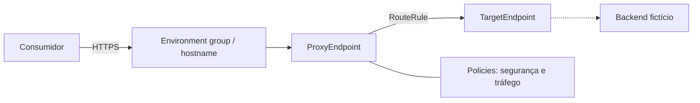
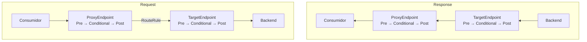
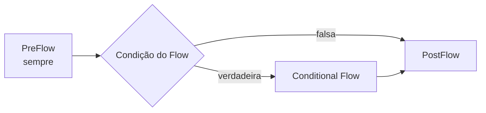

# Arquitetura e modelo de execução

## Visão geral

O laboratório separa contrato público, processamento do gateway e conexão de destino. O Apigee não substitui o backend: ele forma uma camada de gestão e aplicação de políticas.

## Ciclo de uma mensagem

No request, o fluxo atravessa ProxyEndpoint e TargetEndpoint antes do backend. Na resposta, a travessia entre endpoints ocorre no sentido inverso: primeiro o TargetEndpoint e depois o ProxyEndpoint. Em cada pipeline de request ou response, porém, a ordem interna permanece `PreFlow → Conditional Flow → PostFlow`. Somente o primeiro Conditional Flow cuja condição for verdadeira executa em cada segmento. Dentro de cada Flow, os Steps executam na ordem declarada; um erro com `continueOnError="false"` abandona o pipeline normal.

## Progressão do desenho

- **Básico:** fronteira e roteamento explícitos.
- **Intermediário:** autenticação de aplicação, proteção de capacidade, governança de consumo e enriquecimento.
- **Avançado:** identidade por JWT, composição reutilizável e contrato de erros.

Policies são configuração, não substitutos automáticos para decisões arquiteturais. Limites, ordem, condições, identidade, dados sensíveis e observabilidade precisam de critérios próprios. Shared Flows reduzem duplicação, mas criam uma dependência de deploy e versionamento entre artefatos.

## Identidade da aplicação e da credencial

No módulo intermediário, `VerifyAPIKey` valida a consumer key apresentada em `x-api-key` e produz variáveis com a chave e os metadados associados. `verifyapikey.verify-api-key.client_id` contém essa consumer key — também chamada API key ou app key — enquanto `verifyapikey.verify-api-key.developer.app.name` representa o nome da aplicação cadastrada. O proxy usa `client_id` como `Identifier` da Quota, portanto contabiliza por credencial: múltiplas chaves da mesma aplicação e uma chave nova após rotação têm contadores independentes.

Depois da validação, uma `AssignMessage` remove `x-api-key`. As policies seguintes continuam usando as variáveis produzidas por `VerifyAPIKey`, mas a credencial não é enviada ao backend sem necessidade. O módulo avançado aplica o mesmo princípio ao header `Authorization`: valida o JWT, remove o bearer token e envia ao target somente o subject necessário, produzido pelo Shared Flow.

## Falhas e respostas do backend

Uma falha de policy com `continueOnError="false"` tira a mensagem do pipeline normal e leva o endpoint ao tratamento de falhas. `JWT.failed = true` identifica qualquer falha de runtime de uma policy JWT; inclui erros do token e também categorias ligadas a chave ou configuração, não apenas assinatura inválida.

No módulo avançado, as responsabilidades ficam pequenas e explícitas:

- o ProxyEndpoint devolve 401 para `JWT.failed` e 500 genérico para outras falhas locais não tratadas;
- uma falha de conexão no TargetEndpoint, sem resposta HTTP do backend, devolve 502 genérico;
- respostas HTTP 4xx/5xx do backend percorrem o response flow porque `success.codes` foi configurado para 1xx–5xx; uma policy preserva o status e substitui o payload por uma mensagem neutra.

O uso amplo de `success.codes` é uma simplificação didática. Em uma API real, os códigos aceitos e o contrato de erro precisam ser definidos por backend e operação.

## Fronteira do laboratório

Os bundles seguem a estrutura documentada e são verificados por relações que o repositório consegue provar. A plataforma ainda deve validar schemas, disponibilidade de policies/licenças, variáveis em runtime, recursos de organização/environment, conectividade e comportamento distribuído.

Referências: [estrutura de proxies](https://cloud.google.com/apigee/docs/api-platform/fundamentals/structure-api-proxies), [ordem de execução dos flows](https://cloud.google.com/apigee/docs/api-platform/fundamentals/what-are-flows), [Verify API Key](https://cloud.google.com/apigee/docs/api-platform/reference/policies/verify-api-key-policy), [propriedades de endpoints](https://cloud.google.com/apigee/docs/api-platform/reference/endpoint-properties-reference), [tratamento de falhas](https://cloud.google.com/apigee/docs/api-platform/fundamentals/fault-handling) e [Verify JWT](https://cloud.google.com/apigee/docs/api-platform/reference/policies/verify-jwt-policy).
