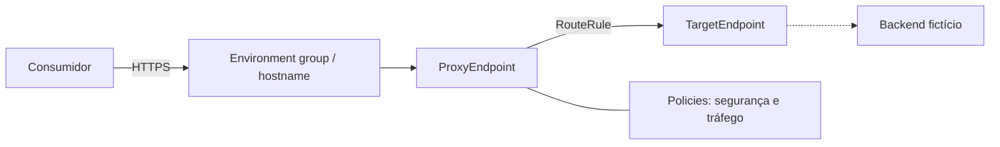
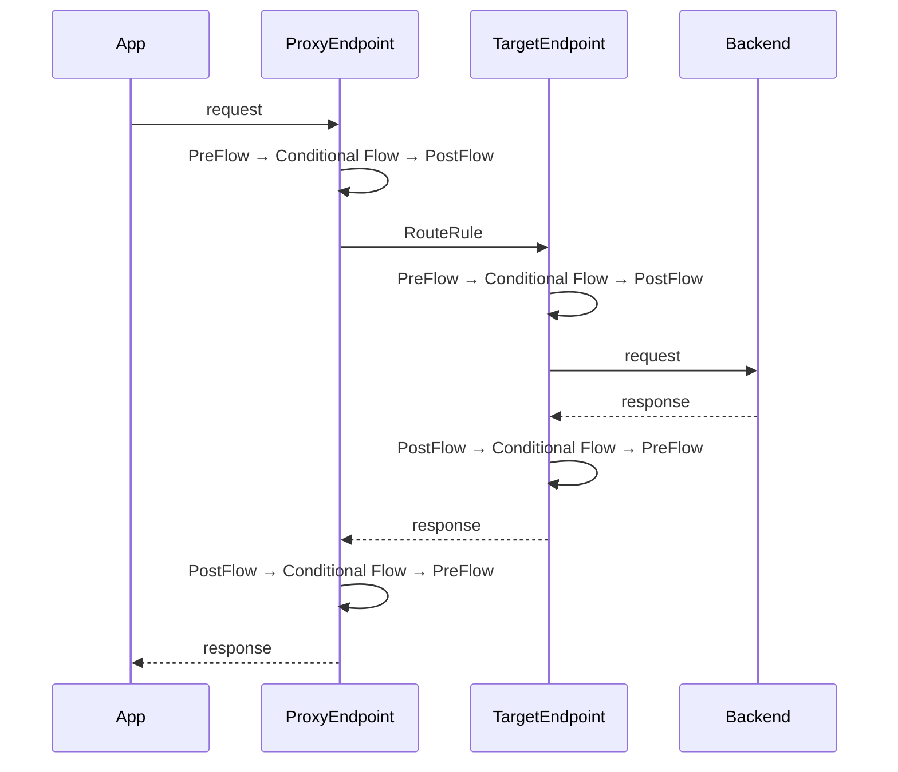
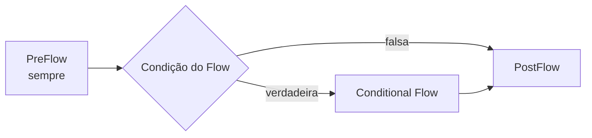

# Arquitetura e modelo de execução

## Visão geral

O laboratório separa contrato público, processamento do gateway e conexão de destino. O Apigee não substitui o backend: ele forma uma camada de gestão e aplicação de políticas.

## Ciclo de uma mensagem

No request, o fluxo atravessa ProxyEndpoint e TargetEndpoint antes do backend. Na resposta, a ordem dos segmentos é invertida. Dentro de um endpoint, Steps de um segmento executam na ordem declarada; um erro com `continueOnError="false"` abandona o pipeline normal.

## Progressão do desenho

- **Básico:** fronteira e roteamento explícitos.
- **Intermediário:** autenticação de aplicação, proteção de capacidade, governança de consumo e enriquecimento.
- **Avançado:** identidade por JWT, composição reutilizável e contrato de erros.

Policies são configuração, não substitutos automáticos para decisões arquiteturais. Limites, ordem, condições, identidade, dados sensíveis e observabilidade precisam de critérios próprios. Shared Flows reduzem duplicação, mas criam uma dependência de deploy e versionamento entre artefatos.

## Fronteira do laboratório

Os bundles seguem a estrutura documentada e são verificados por relações que o repositório consegue provar. A plataforma ainda deve validar schemas, disponibilidade de policies/licenças, variáveis em runtime, recursos de organização/environment, conectividade e comportamento distribuído.

Referências: [estrutura de proxies](https://cloud.google.com/apigee/docs/api-platform/fundamentals/structure-api-proxies), [configuração de flows](https://cloud.google.com/apigee/docs/api-platform/reference/flow-configuration-reference) e [variáveis de flow](https://cloud.google.com/apigee/docs/api-platform/fundamentals/introduction-flow-variables).
