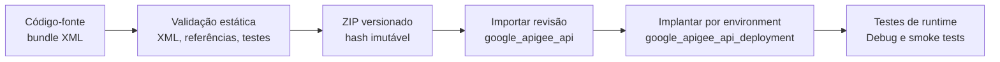

# Bundles e ciclo de implantação com Terraform

## Separar artefato e provisionamento

O bundle XML descreve o comportamento do API Proxy; Terraform pode importar esse artefato e gerenciar sua implantação junto de recursos de plataforma. Essa separação mantém policies, Flows e endpoints revisáveis sem transformar o código do proxy em definição de rede, organização ou environment.

O provider Google documenta `google_apigee_api`, que recebe um `config_bundle`, e `google_apigee_api_deployment`, que associa uma revisão do proxy a um environment. Esses nomes são recursos públicos do provider, não módulos internos. Este laboratório não inclui configuração Terraform executável porque não possui organização, environments, backend remoto nem estado compartilhado.

## Estratégia recomendada para um pipeline

- Produzir o ZIP de maneira determinística e associar hash, commit e versão do bundle ao artefato de CI.
- Executar parsing XML, referências entre Steps/policies e RouteRules/TargetEndpoints, testes e revisão de segurança antes da importação.
- Encapsular repetição em módulos Terraform reutilizáveis com entradas pequenas e documentadas, sem esconder dependências entre proxy, environment, KVM, Shared Flow e deployment.
- Usar referências de recursos e `depends_on` somente quando a dependência não puder ser inferida. Shared Flows e configurações externas necessárias devem existir antes do proxy consumidor.
- Promover o mesmo artefato entre environments; valores ambientais, como a KVM do exemplo, permanecem fora do ZIP.
- Tratar uma nova importação como nova revisão. Definir retenção, rollback e remoção de revisões conforme os limites e o processo da organização.
- Validar em environment não produtivo com import/deploy, Debug, testes funcionais e de falha. A validação deste repositório é somente estática.

## Estado remoto

Estado Terraform pode conter identificadores e atributos operacionais. Em trabalho colaborativo, use backend remoto com criptografia, controle de acesso mínimo, locking quando suportado, versionamento/recuperação e trilha de auditoria. Não armazene o arquivo de estado no Git nem exponha seus outputs em logs. Separar estados por fronteira de responsabilidade e ambiente reduz blast radius, mas aumenta a necessidade de contratos explícitos entre stacks.

Referências oficiais: [recurso `google_apigee_api`](https://registry.terraform.io/providers/hashicorp/google/latest/docs/resources/apigee_api), [recurso `google_apigee_api_deployment`](https://registry.terraform.io/providers/hashicorp/google/latest/docs/resources/apigee_api_deployment) e [estado remoto do Terraform](https://developer.hashicorp.com/terraform/language/state/remote).
