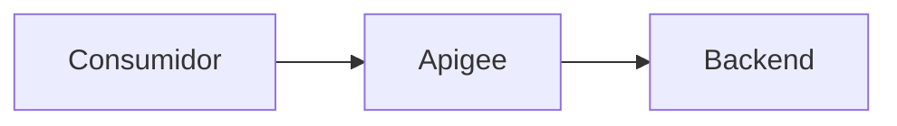
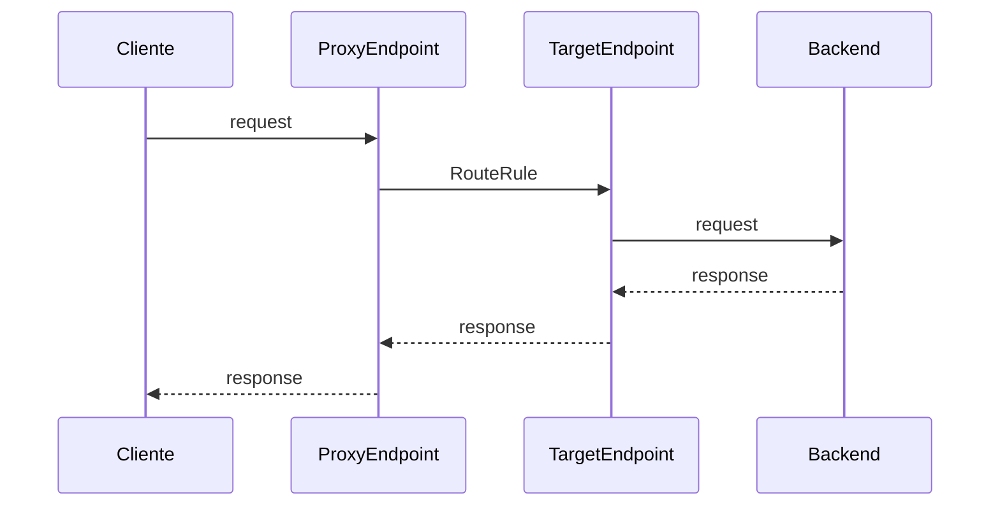
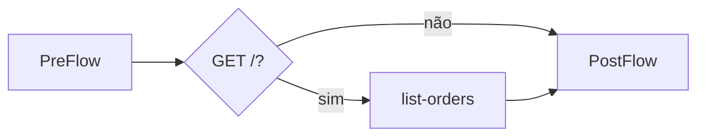
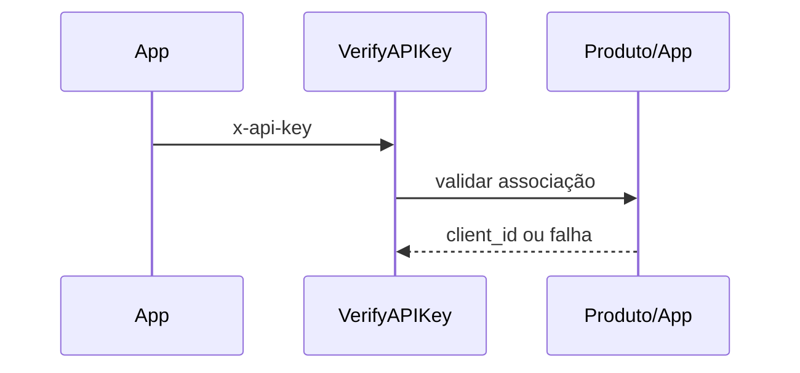
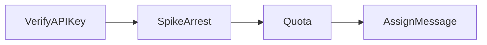
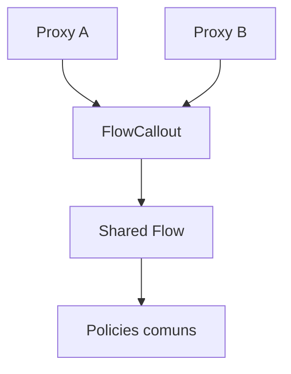
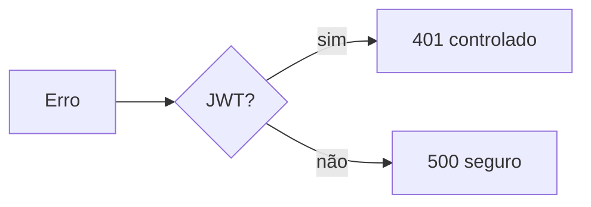

# Roteiro de apresentação — 30 minutos

Público: desenvolvedores e arquitetos. Os tempos somam 30 minutos e deixam perguntas para depois da sessão.

## Slide 1 — Por que uma camada de API? (2 min)

- **Objetivo:** alinhar problema e escopo.
- **Conceitos:** contrato, desacoplamento, gateway versus API Management.
- **Fala sugerida:** “O gateway está no caminho da chamada; API Management governa também ciclo de vida, segurança e consumo. Aqui estudaremos a configuração declarativa do runtime, não uma plataforma produtiva pronta.”
- **Exemplo:** `README.md` e cenário de pedidos.
- **Mensagem principal:** o proxy é uma fronteira administrada, não apenas um redirecionamento.

## Slide 2 — Anatomia do bundle (2 min)

- **Objetivo:** localizar os elementos no repositório.
- **Conceitos:** descritor, `ProxyEndpoint`, `TargetEndpoint`, policies e resources.
- **Fala sugerida:** mostre que nomes são contratos entre arquivos: Step referencia policy; RouteRule referencia TargetEndpoint.
- **Exemplo:** `examples/01-basic/apiproxy/`.
- **Mensagem principal:** a estrutura de diretórios também faz parte do artefato implantável.

## Slide 3 — Caminho completo da mensagem (3 min)

- **Objetivo:** explicar a ordem temporal.
- **Conceitos:** request/response, segmentos de proxy e target.
- **Fala sugerida:** acompanhe a ida até o backend e destaque a ordem inversa dos segmentos na resposta.
- **Exemplo:** `examples/01-basic/apiproxy/proxies/default.xml`.
- **Mensagem principal:** a localização de uma policy determina quando e sobre qual mensagem ela atua.

## Slide 4 — PreFlow, condição e PostFlow (3 min)

- **Objetivo:** diferenciar lógica transversal de lógica por operação.
- **Conceitos:** PreFlow sempre executado, Conditions e PostFlow.
- **Fala sugerida:** autenticação pertence ao PreFlow; comportamento apenas de listagem pode ficar no flow `list-orders`; pós-processamento comum cabe no PostFlow.
- **Exemplo:** `examples/02-intermediate/apiproxy/proxies/default.xml`.
- **Mensagem principal:** condições expressam intenção de negócio; a ordem dos Steps expressa dependências.

## Slide 5 — API key como identidade da aplicação (3 min)

- **Objetivo:** demonstrar controle de acesso de aplicações.
- **Conceitos:** API product, developer app, key e `client_id`.
- **Fala sugerida:** a policy extrai `x-api-key`, mas a autorização depende de metadados criados no Apigee. API key identifica a aplicação; não autentica necessariamente o usuário final.
- **Exemplo:** `policies/verify-api-key.xml` do módulo 02.
- **Mensagem principal:** configuração XML e recursos de gestão precisam existir em conjunto.

## Slide 6 — Proteger capacidade e governar consumo (3 min)

- **Objetivo:** separar SpikeArrest de Quota.
- **Conceitos:** rajadas, taxa suavizada, janela e identificador.
- **Fala sugerida:** SpikeArrest reduz picos instantâneos; Quota contabiliza uso por `client_id`. Os valores do laboratório ensinam sintaxe, não são dimensionamento de produção.
- **Exemplo:** `spike-arrest.xml` e `quota.xml`.
- **Mensagem principal:** limites são decisões de capacidade e produto apoiadas por métricas.

## Slide 7 — Compor a cadeia de policies (3 min)

- **Objetivo:** tornar explícita a dependência entre etapas.
- **Conceitos:** fail-closed, variáveis de flow e AssignMessage.
- **Fala sugerida:** VerifyAPIKey produz `client_id`, consumido pela Quota; o correlation ID só é adicionado após os controles. Uma falha interrompe os Steps seguintes.
- **Exemplo:** PreFlow do módulo 02.
- **Mensagem principal:** uma policy correta na posição errada ainda produz uma arquitetura incorreta.

## Slide 8 — JWT e fronteiras de confiança (3 min)

- **Objetivo:** introduzir identidade assinada e validação local.
- **Conceitos:** RS256, issuer, audience, expiração e JWKS.
- **Fala sugerida:** assinatura válida não basta: valide emissor e público. O bundle espera JWKS em variável privada e não implementa obtenção ou rotação de chaves.
- **Exemplo:** `examples/03-advanced/orders-advanced/apiproxy/policies/verify-jwt.xml`.
- **Mensagem principal:** chaves e claims formam uma fronteira de confiança que precisa de operação segura.

## Slide 9 — Reutilização com Shared Flows (3 min)

- **Objetivo:** mostrar composição sem copiar policies.
- **Conceitos:** SharedFlowBundle, FlowCallout e dependência de deploy.
- **Fala sugerida:** o consumidor chama um bundle implantado no mesmo environment. O Shared Flow não é endpoint e deve ser implantado antes do proxy.
- **Exemplo:** os dois bundles do módulo 03.
- **Mensagem principal:** reuso reduz divergência, mas exige governança de versão e rollout.

## Slide 10 — Falhas como parte do contrato (2 min)

- **Objetivo:** explicar a transição para o estado de erro.
- **Conceitos:** FaultRule, DefaultFaultRule e mensagens não reveladoras.
- **Fala sugerida:** falhas encerram o pipeline normal; `JWT.failed` direciona todas as falhas das policies JWT para 401 e o fallback cobre o restante. ProxyEndpoint e TargetEndpoint têm handlers próprios porque a regra deve estar no endpoint onde o erro ocorre.
- **Exemplo:** FaultRules do ProxyEndpoint avançado.
- **Mensagem principal:** respostas de erro precisam ser desenhadas e testadas como respostas de sucesso.

## Slide 11 — Guardrails e próximos passos (3 min)

- **Objetivo:** encerrar com uma fronteira honesta de validação.
- **Conceitos:** XML, integridade referencial, CI mínima e validação de plataforma.
- **Fala sugerida:** execute o script e os testes. Mostre que a CI falha cedo sem credenciais, mas não promete compatibilidade semântica. Próximos passos possíveis: ambiente sandbox, testes de runtime, OpenAPI, observabilidade e gestão segura de configuração.
- **Exemplo:** `scripts/validate_bundles.py`, `tests/` e `.github/workflows/validate.yml`.
- **Mensagem principal:** automação local reduz erros; somente Apigee e testes reais confirmam comportamento de execução.
