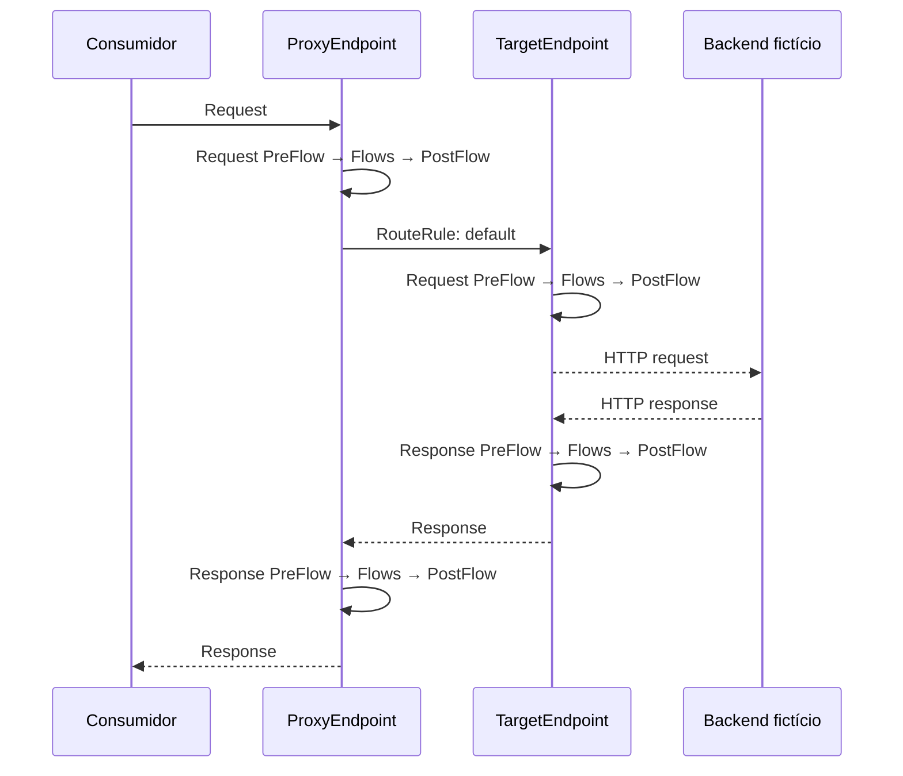

# 01 — Proxy básico / Basic proxy

## Português

**Problema:** publicar uma interface estável para pedidos e desacoplá-la da URL do serviço interno. O bundle é estruturalmente completo, mas o destino `orders-backend.example.invalid` é intencionalmente inalcançável.

**Conceitos e arquivos:** `orders-basic.xml` identifica o bundle; `proxies/default.xml` expõe `/lab/v1/orders-basic`, contém os fluxos e a `RouteRule`; `targets/default.xml` representa a conexão HTTP de saída. Não há policies neste estágio.

**Comportamento esperado:** no Apigee, toda chamada no BasePath é roteada ao `TargetEndpoint default`. No request, os segmentos executam `ProxyEndpoint → TargetEndpoint → backend`; na response, `backend → TargetEndpoint → ProxyEndpoint`. Dentro do request ou da response de cada endpoint, a ordem continua `PreFlow → primeiro Conditional Flow compatível → PostFlow`. Como o host usa `.invalid`, a chamada real termina em erro de resolução até que um backend de laboratório seja configurado.

**Implicações e boas práticas:** preservar o contrato externo permite evoluir o backend; preferir TargetEndpoints nomeados a URLs diretas na RouteRule mantém conexão e políticas de destino encapsuladas. TLS, timeouts, observabilidade e DNS continuam decisões de runtime.

## English

**Problem:** expose a stable orders interface while decoupling it from the internal service URL. The bundle is structurally complete, but `orders-backend.example.invalid` is intentionally unreachable.

**Concepts and files:** `orders-basic.xml` identifies the bundle; `proxies/default.xml` exposes the BasePath, flows, and RouteRule; `targets/default.xml` models the outbound HTTP connection. No policies are used yet.

**Expected behavior and limits:** Apigee routes every BasePath request to the named target and the response follows the reverse flow. A real call fails DNS resolution until a lab backend is supplied. Named targets keep connection concerns separate; production still needs TLS, timeout, DNS, and observability decisions.

[Apigee proxy configuration reference](https://cloud.google.com/apigee/docs/api-platform/reference/api-proxy-configuration-reference)
