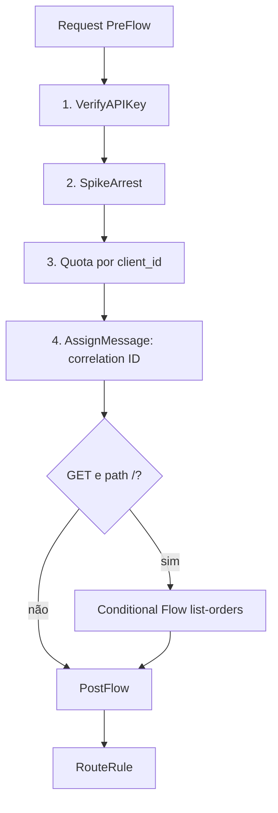
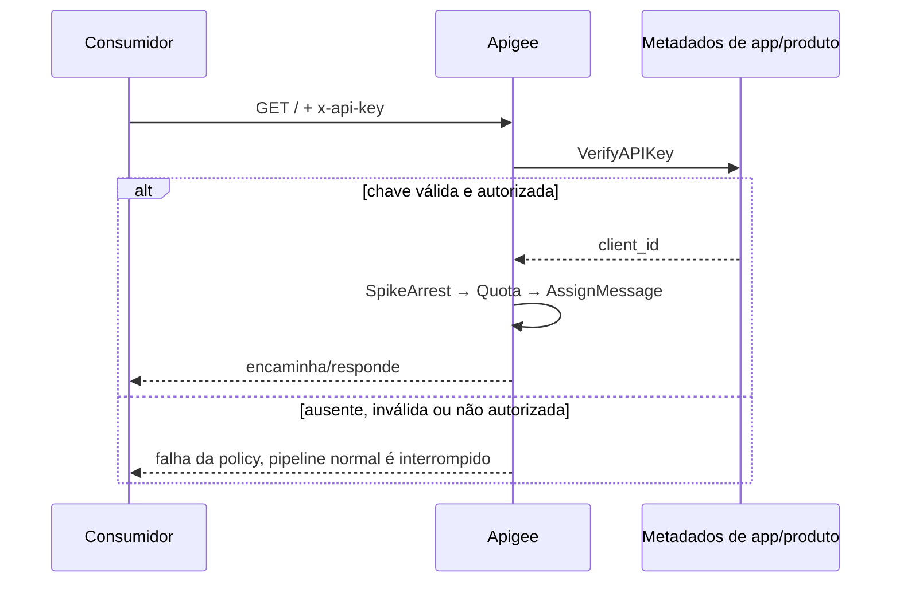

# 02 — Controles intermediários / Intermediate controls

## Português

**Problema:** impedir acesso anônimo, suavizar picos, limitar consumo por aplicação e propagar correlação. O exemplo acrescenta um fluxo condicional para `GET /`, mostrando onde lógica específica de operação seria anexada.

**Responsabilidade dos arquivos:** o descritor `orders-intermediate.xml` nomeia o bundle; o ProxyEndpoint ordena policies e declara o Conditional Flow; o TargetEndpoint contém o destino fictício. Em `policies/`, `verify-api-key.xml` lê `x-api-key`; `spike-arrest.xml` suaviza a taxa em `10ps`; `quota.xml` limita cada `client_id` verificado a 100 chamadas por minuto; `assign-correlation-id.xml` envia o `messageid` ao backend.

**Comportamento e dependências:** a configuração é analisável estaticamente, mas `VerifyAPIKey` só funciona com API product, developer app e chave associados ao proxy/recurso. A Quota depende do `client_id` produzido pela policy anterior. SpikeArrest protege contra rajadas, enquanto Quota governa consumo em uma janela; não são controles equivalentes.

**Boas práticas:** autenticar antes de contabilizar a quota por consumidor; dimensionar limites com testes; não usar `messageid` como identificador de negócio; definir respostas de erro consistentes (introduzidas no módulo 03). `Distributed` e `Synchronous` dão contagem coordenada, mas a sincronização por chamada pode reduzir throughput e deve ser uma escolha consciente. O backend continua deliberadamente ausente.

## English

**Problem:** block anonymous access, smooth spikes, cap per-application consumption, and propagate correlation. A Conditional Flow for `GET /` shows where operation-specific logic belongs.

The ProxyEndpoint executes `VerifyAPIKey → SpikeArrest → Quota → AssignMessage`; its XML also declares the conditional flow and routing. Individual files under `policies/` keep each concern explicit, while the TargetEndpoint remains fictitious.

The bundle is statically checkable, but runtime API-key verification requires an API product, developer app, and issued key. Quota consumes the verified `client_id`. SpikeArrest controls bursts; Quota governs consumption over a window. Synchronous distributed counting favors strictness but may reduce throughput. Authenticate before per-consumer accounting, size limits from evidence, and do not treat `messageid` as a business identifier.

[Verify API Key](https://cloud.google.com/apigee/docs/api-platform/reference/policies/verify-api-key-policy) · [Spike Arrest](https://cloud.google.com/apigee/docs/api-platform/reference/policies/spike-arrest-policy) · [Quota](https://cloud.google.com/apigee/docs/api-platform/reference/policies/quota-policy) · [Assign Message](https://cloud.google.com/apigee/docs/api-platform/reference/policies/assign-message-policy)
