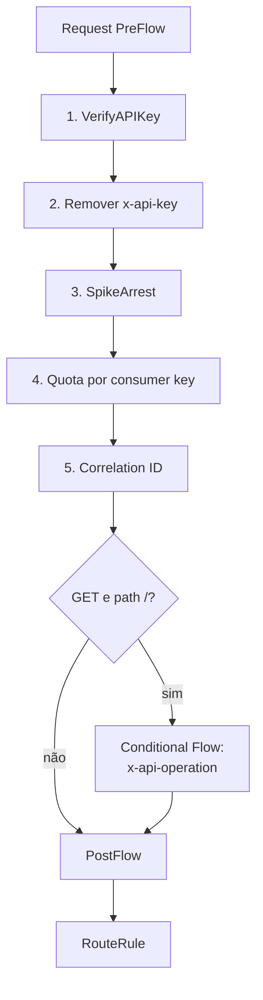
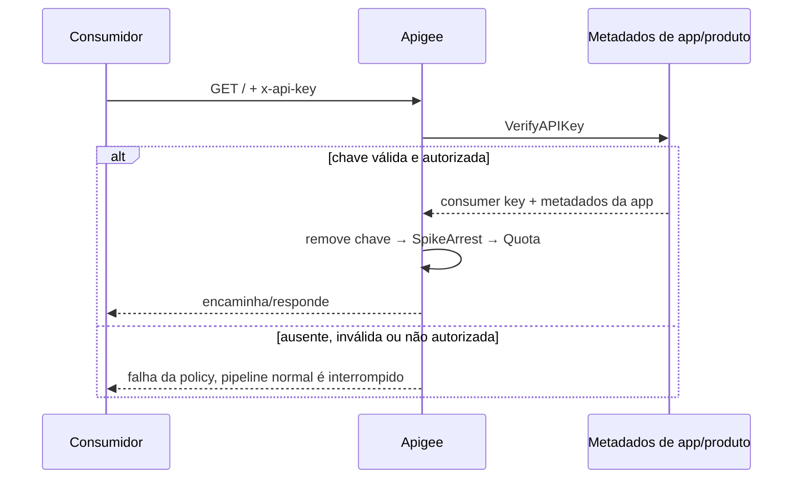

# 02 — Controles intermediários / Intermediate controls

## Português

**Problema:** impedir acesso anônimo, controlar rajadas, limitar consumo por credencial e propagar apenas o contexto necessário ao backend. O exemplo também torna concreto o Conditional Flow de `GET /`: ele acrescenta `x-api-operation: list-orders`, um metadado técnico fixo, sem executar lógica de negócio.

**Responsabilidade dos arquivos:** o descritor `orders-intermediate.xml` nomeia o bundle; o ProxyEndpoint ordena policies e declara o Conditional Flow; o TargetEndpoint contém o destino fictício. Em `policies/`, `verify-api-key.xml` lê `x-api-key`; `remove-api-key.xml` retira a credencial validada da requisição; `spike-arrest.xml` limita o proxy a `10ps` com contagem efetiva regional (`UseEffectiveCount=true`), sem identificador por cliente; `quota.xml` limita cada consumer key validada a 100 chamadas por minuto; `assign-correlation-id.xml` envia o `messageid`; e `assign-list-orders-context.xml` marca somente a operação `GET /`.

**Identidade e Quota:** a configuração é analisável estaticamente, mas `VerifyAPIKey` só funciona com API product, developer app e consumer key associados ao proxy/recurso. A variável `verifyapikey.verify-api-key.client_id` contém a própria consumer key apresentada — sinônimo de API key/app key — e não o ID lógico da aplicação. A policy também produz metadados como `developer.app.name`; este laboratório usa a credencial como `Identifier` da Quota. Portanto, duas chaves válidas da mesma aplicação têm contadores distintos e a rotação para uma nova chave inicia outro contador. Essa escolha é simples e útil para ensinar a dependência entre policies, mas não deve ser descrita como uma quota agregada por aplicação.

**Comportamento esperado:** após uma chave válida ser verificada, `x-api-key` é removido antes do roteamento, pois o backend não precisa dessa credencial. SpikeArrest protege o proxy contra rajadas com uma janela deslizante regional; Quota governa cada consumer key numa janela móvel. Para `GET /`, o primeiro Conditional Flow compatível executa e adiciona o header técnico `x-api-operation`; outras operações seguem ao PostFlow sem esse Step. SpikeArrest e Quota não são controles equivalentes.

**Boas práticas e limites:** validar antes de remover a credencial e contabilizar a quota; não propagar segredos sem necessidade; dimensionar limites com testes; não usar `messageid` como identificador de negócio. `Distributed` e `Synchronous` dão contagem coordenada, mas a sincronização por chamada pode reduzir throughput e deve ser uma escolha consciente. Uma quota realmente agregada por aplicação exigiria escolher um identificador estável compatível com o domínio e com as recomendações da plataforma; isso fica fora do laboratório. O backend continua deliberadamente ausente.

## English

**Problem:** block anonymous access, control bursts, cap per-application consumption, and propagate correlation. A Conditional Flow for `GET /` acts as a structural marker: its `Request` and `Response` blocks are empty, so it executes no business behavior. It only shows where operation-specific Steps could be attached.

The ProxyEndpoint executes `VerifyAPIKey → SpikeArrest → Quota → AssignMessage`; its XML also declares the conditional flow and routing. Individual files under `policies/` keep each concern explicit, while the TargetEndpoint remains fictitious.

The bundle is statically checkable, but runtime API-key verification requires an API product, developer app, and issued key. Quota consumes the verified `client_id`. With `UseEffectiveCount=true`, SpikeArrest uses a regional sliding window for the whole proxy because no client identifier is configured; Quota governs each application's rolling-window consumption. Synchronous distributed quota counting favors strictness but may reduce throughput. Authenticate before per-consumer accounting, size limits from evidence, and do not treat `messageid` as a business identifier.

[Verify API Key](https://cloud.google.com/apigee/docs/api-platform/reference/policies/verify-api-key-policy) · [Spike Arrest](https://cloud.google.com/apigee/docs/api-platform/reference/policies/spike-arrest-policy) · [Quota](https://cloud.google.com/apigee/docs/api-platform/reference/policies/quota-policy) · [Assign Message](https://cloud.google.com/apigee/docs/api-platform/reference/policies/assign-message-policy)
