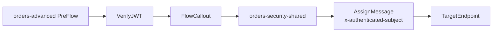
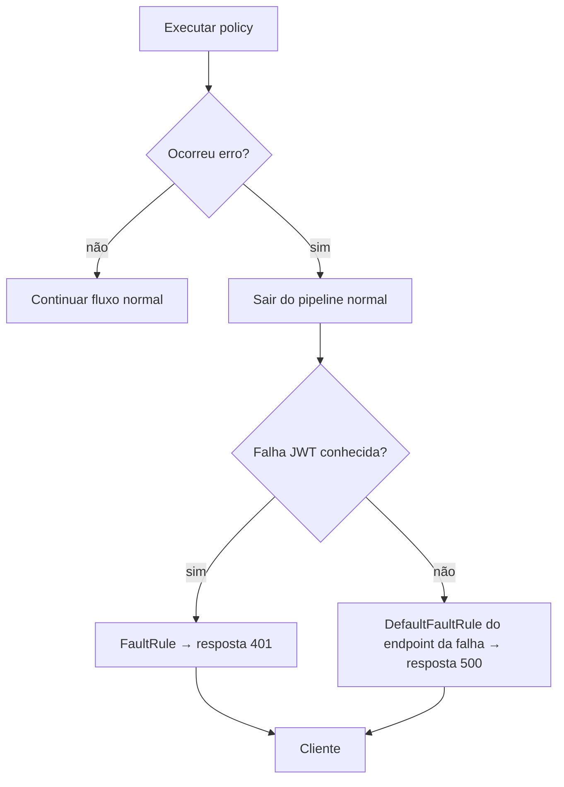

# 03 — Segurança e reutilização avançadas / Advanced security and reuse

## Português

**Problema:** validar tokens assimétricos, centralizar comportamento reutilizável e devolver falhas seguras e previsíveis. O módulo contém dois artefatos independentes: `orders-security-shared/sharedflowbundle/` e o consumidor `orders-advanced/apiproxy/`.

**Arquivos e sequência:** `verify-jwt.xml` verifica RS256, emissor, audience e JWKS obtido de `private.orders.jwks`; `call-shared-security.xml` invoca `orders-security-shared`; o Shared Flow executa `assign-security-context.xml` para propagar o subject validado. `assign-auth-fault.xml` trata qualquer falha de uma policy JWT, identificada pela variável documentada `JWT.failed`; `assign-default-fault.xml` evita expor detalhes nas demais falhas, inclusive erros de conexão tratados pelo `DefaultFaultRule` do TargetEndpoint.

**Comportamento e dependências:** os XMLs e referências locais são validáveis. Em runtime, o token é lido por padrão de `Authorization: Bearer ...`, o prefixo é removido pela policy e a variável privada deve conter um documento JWKS confiável; um mecanismo seguro, fora deste repositório, deve preenchê-la. O Shared Flow deve ser importado e implantado no mesmo environment antes do proxy consumidor. Shared Flows não recebem tráfego diretamente.

**Limitações e decisões:** a URL de issuer usa `.invalid` como contrato fictício, não como integração. O laboratório não demonstra obtenção/rotação de chaves, cache, autorização por scopes, logging ou mascaramento. Reutilizar apenas preocupações realmente comuns evita acoplamento; FaultRules pertencem ao endpoint onde a falha pode ocorrer. Mensagens externas são estáveis e não vazam `fault.name` ou detalhes internos.

## English

**Problem:** verify asymmetric tokens, centralize reusable behavior, and return safe, predictable failures. This module has two independent artifacts: a shared-flow bundle and its consuming API proxy.

The proxy executes `VerifyJWT → FlowCallout`; the shared flow adds the verified subject to the target request. VerifyJWT uses its default `Authorization: Bearer ...` source behavior. The documented `JWT.failed` variable routes every JWT-policy failure to a controlled 401. Proxy and target DefaultFaultRules provide non-disclosing fallbacks, including target connection failures. Runtime requires trusted JWKS in `private.orders.jwks`, secure key lifecycle management, and deployment of the shared flow to the same environment before the proxy. Shared flows cannot receive traffic directly.

The `.invalid` issuer is a fictitious contract, not an integration. Key retrieval/rotation, caching, scope authorization, logging, and masking are intentionally out of scope. Reuse only genuinely shared concerns and place FaultRules at the endpoint where errors can arise.

[Verify JWT](https://cloud.google.com/apigee/docs/api-platform/reference/policies/verify-jwt-policy) · [Flow Callout](https://cloud.google.com/apigee/docs/api-platform/reference/policies/flow-callout-policy) · [Shared Flows](https://cloud.google.com/apigee/docs/api-platform/fundamentals/shared-flows) · [Fault handling](https://cloud.google.com/apigee/docs/api-platform/fundamentals/fault-handling)
