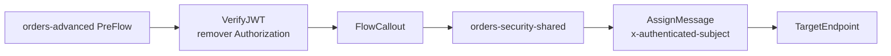
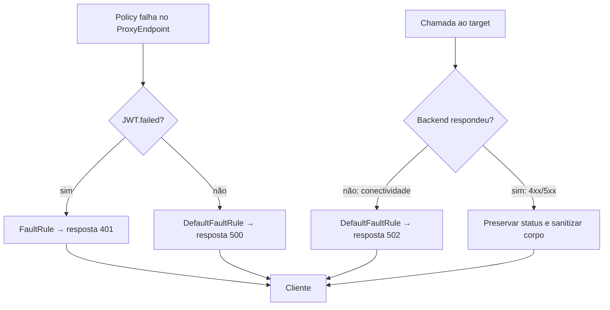

# 03 — Segurança e reutilização avançadas / Advanced security and reuse

## Português

**Problema:** validar tokens assimétricos, centralizar comportamento reutilizável e distinguir falhas do gateway, indisponibilidade do target e respostas HTTP do backend. O módulo contém dois artefatos independentes: `orders-security-shared/sharedflowbundle/` e o consumidor `orders-advanced/apiproxy/`.

**Arquivos e sequência:** `verify-jwt.xml` verifica RS256, emissor, audience e JWKS obtido de `private.orders.jwks`; `remove-authorization.xml` retira o bearer token já validado; `call-shared-security.xml` invoca `orders-security-shared`; o Shared Flow executa `assign-security-context.xml` para propagar apenas o subject validado. No ProxyEndpoint, `assign-auth-fault.xml` responde 401 às falhas sinalizadas por `JWT.failed` e `assign-default-fault.xml` mantém um 500 genérico para outras falhas de policy. No TargetEndpoint, `success.codes` aceita 1xx–5xx no pipeline normal, `sanitize-backend-error.xml` substitui o corpo de respostas 4xx/5xx sem alterar o status original e `assign-target-fault.xml` devolve 502 para falhas de conexão sem resposta HTTP do backend.

**Comportamento e dependências:** os XMLs e referências locais são validáveis. Em runtime, o token é lido por padrão de `Authorization: Bearer ...`, o prefixo é removido para validação pela policy e a variável privada deve conter um documento JWKS confiável; um mecanismo seguro, fora deste repositório, deve preenchê-la. O Shared Flow deve ser importado e implantado no mesmo environment antes do proxy consumidor. Shared Flows não recebem tráfego diretamente.

`JWT.failed = true` é uma sinalização compartilhada por todas as policies JWT quando ocorre uma falha de runtime; ela não significa somente “assinatura inválida”. Pode cobrir token malformado, expirado, ainda não válido, issuer/audience/claims incompatíveis, chave não correspondente e também falhas de chave/configuração em runtime. O exemplo agrupa essas categorias em 401 para manter o fluxo didático pequeno, seguindo os status documentados pela policy. Em produção, falhas operacionais de JWKS/configuração devem ser separadas e monitoradas para não serem confundidas com erro do consumidor.

**Limitações e decisões:** a URL de issuer usa `.invalid` como contrato fictício, não como integração. O laboratório não demonstra obtenção/rotação de chaves, cache, autorização por scopes, logging ou mascaramento completo de headers. Reutilizar apenas preocupações realmente comuns evita acoplamento; FaultRules pertencem ao endpoint onde a falha pode ocorrer. Respostas do backend preservam o status, mas recebem payload genérico; falhas locais não expõem `fault.name`, URLs ou detalhes internos. A propriedade ampla de `success.codes` existe apenas para demonstrar a distinção entre resposta HTTP e falha de transporte; contratos reais devem definir quais códigos são aceitos e como cada payload é tratado.

## English

**Problem:** verify asymmetric tokens, centralize reusable behavior, and return safe, predictable failures. This module has two independent artifacts: a shared-flow bundle and its consuming API proxy.

The proxy executes `VerifyJWT → FlowCallout`; the shared flow adds the verified subject to the target request. VerifyJWT uses its default `Authorization: Bearer ...` source behavior. The documented `JWT.failed` variable routes every JWT-policy failure to a controlled 401. Proxy and target DefaultFaultRules provide non-disclosing fallbacks, including target connection failures. Runtime requires trusted JWKS in `private.orders.jwks`, secure key lifecycle management, and deployment of the shared flow to the same environment before the proxy. Shared flows cannot receive traffic directly.

The `.invalid` issuer is a fictitious contract, not an integration. Key retrieval/rotation, caching, scope authorization, logging, and masking are intentionally out of scope. Reuse only genuinely shared concerns and place FaultRules at the endpoint where errors can arise.

[Verify JWT](https://cloud.google.com/apigee/docs/api-platform/reference/policies/verify-jwt-policy) · [Flow Callout](https://cloud.google.com/apigee/docs/api-platform/reference/policies/flow-callout-policy) · [Shared Flows](https://cloud.google.com/apigee/docs/api-platform/fundamentals/shared-flows) · [Fault handling](https://cloud.google.com/apigee/docs/api-platform/fundamentals/fault-handling)
